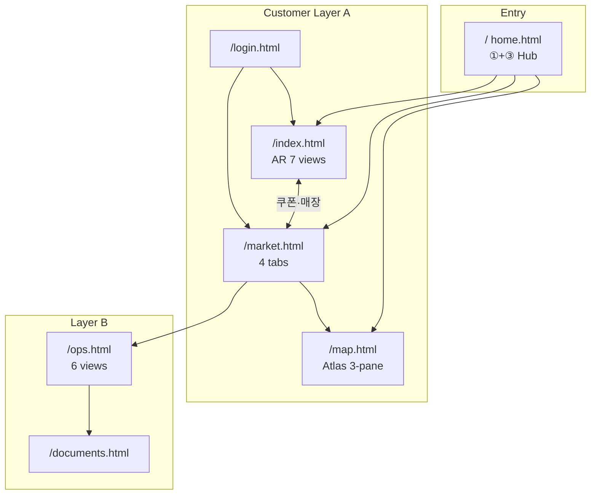

# 가락랜드 통합 디자인 기획서

[v1.0 · 2026-10-30 · 분산 템플릿 전수 목록 + ①+③ 추천안 기준 통합 설계]

**정본 코드:** `E:\currsor_C\blog\garakland`  
**추천 방향:** 홈 시안 **① 테마파크 3D(STUDIO)** + **③ 특가 커머스(MARKET)** 결합 — `home.html` 1차 반영 완료, **전 모듈 토큰·컴포넌트·내비 통합**은 본 문서 Phase 1~4.

---

## 1. 분산 디자인·템플릿 전수 목록

### 1-A. 페이지 HTML (화면 템플릿)

| ID | 파일 | 제품 모듈 | CSS 의존 | 역할 |
|----|------|-----------|----------|------|
| H0 | `home.html` | Platform Hub | `game/style.css` + `game/studio.css` + `platform-home.css` | `/` 통합 홈 · AR+특가 브릿지 |
| H1 | `index.html` | AR Quest v4 | `game/style.css` + `game/studio.css` | 7탭 SPA · 탐험·쿠폰·상인 |
| H2 | `market.html` | Market Growth v5 | `market/theme.css` | 특가·지갑·마케팅·상인 대시보드 |
| H3 | `map.html` | Map Atlas | `src/styles.css` + `src/studio-map.css` | 3-pane 지도·매장 도감 |
| H4 | `ops.html` | ERP v6 | `ops/style.css` | 6뷰 운영센터 |
| H5 | `documents.html` | ERP 서류 | `ops/style.css` + inline | Word 5종·CSV 다운로드 |
| H6 | `login.html` | Neon Auth | `auth/login.css` | 로그인·세션 |
| H7 | `design_gallery.html` | QA only | **inline `<style>`** | v4 검수 PNG 갤러리 |
| H8 | `unsubscribe.html` | Compliance | (페이지 자체 최소) | 수신 철회 |
| — | `platform.css` | **레거시** | 단독 | v1 초기 허브 — **H0 전환 후 deprecate** |

**핸드오프 동일본:** `garakland-handoff-temp/01_LATEST_RUNNABLE/GARAKLAND_V7/` (파일명 동일)

---

### 1-B. CSS 디자인 시스템 (6계열 + 보조)

| 계열 | 파일 | 폰트·키 컬러 | 사용처 | 시안 매핑 |
|------|------|-------------|--------|-----------|
| **STUDIO** | `game/studio.css` | Manrope · `#d6ef72` lime · deep green hero | AR UI 레이어 | ①④ |
| **QUEST base** | `game/style.css` | Manrope/DM Sans · `--lime` · sidebar grid | AR 레이아웃·다이얼로그 | ① |
| **MARKET** | `market/theme.css` | DM Sans · `#007b53` · gold outline | 특가·쿠폰·상품권 | ③ |
| **ATLAS** | `src/styles.css` | Manrope · teal/orange · 3-column workspace | Google 지도 SPA | ① 지도 |
| **ATLAS+** | `src/studio-map.css` | STUDIO 톤 보조 | map.html 연결 | ① |
| **OPS** | `ops/style.css` | Pretendard · `#006748` · gold gem | ERP·서류 | 운영(별 톤) |
| **AUTH** | `auth/login.css` | Pretendard · green gradient | login | 공통 인증 |
| **HOME** | `platform-home.css` | STUDIO 상속 + sticky top + mobile 5탭 | home only | ①+③ |

**문제:** 토큰 변수명·CTA 색·헤더 높이·카드 radius가 **모듈마다 다름** → Phase 1에서 `design/tokens.css`로 수렴 필요.

---

### 1-C. 이미지·그래픽 템플릿

| 경로 | 종류 | HTML 참조 | 용도 |
|------|------|-----------|------|
| `assets/editorial/*.webp` | AI 6종 + collage jpg | `index.html`, `home.html` | 에디토리얼·히어로·구역 카드 |
| `assets/v5/*.webp` | AI 5종 + giftcard | `market.html`, `market/ui.js`, `platform-home.js` | 특가 카드·에디토리얼 블록 |
| `assets/v6/market-hero.webp` | AI 히어로(한글 간판 없음) | `market/theme.css`, `home.html` | 히어로 BG·gift visual |
| `assets/v6/market-photo-source.png` | 원본 | 생성 파이프라인 | v6 재생성용 |
| `assets/demo/*-{hero,menu,poster}.png` | 스크립트 생성 | `game/app.js` 시연 매장 | 가상 매장 카드 |
| `assets/icon.svg` | 브랜드 마크 | 전 페이지 favicon | |
| `generate_assets.py` | **템플릿 생성기** | demo PNG | 베타 매장 포스터·메뉴 |

**검수·레퍼런스 PNG (루트·docs):**

| 패턴 | 위치 | 대응 화면 |
|------|------|-----------|
| `v4_desktop_*.png`, `v4_mobile_*.png` | repo root | `design_gallery.html` · AR 9화면 |
| `v5_desktop_*.png`, `v5_mobile_*.png` | repo root | market 4화면 |
| `preview_*.png` | repo root | 초기 프리뷰 |
| `docs/v6/screens/erp_*_{desktop,mobile}.png` | docs | ERP 6화면 |
| `docs/v6/*.webp` | docs | Word·ERP 검수 캡처 |

**리포 외 (기획 참고):** 홈 시안 5종 PNG (`01_테마파크` … `05_마켓가이드`) — 이전 AI 납품 ZIP, git 미포함.

---

### 1-D. 문서·기획 템플릿 (디자인 의사결정 근거)

| 파일 | 내용 |
|------|------|
| `README_V4_DESIGN.md` | STUDIO v4 디자인 업그레이드 정본 |
| `docs/디자인_페이지별_검수_v4.md` | 페이지별 UX·컴포넌트·한계 |
| `README_V6_ERP_RELEASE.md` | v6 히어로 webp 정책·ERP UI |
| `docs/v6/페이지별_UI_검수_및_출시판정.md` | ERP 출시 판정 |
| `docs/PLATFORM_V1_INTEGRATION.md` | 모듈 URL·시안 5종 매핑 |
| `docs/PRD_v3_현장플레이_기획.md` | 초기 제품 PRD |
| `docs/검수_리포트_v5.md`, `docs/검수결과_한계.md` | v5 QA |
| `V4_MANIFEST.json`, `V5_MANIFEST.json`, `V6_FILE_MANIFEST.json`, `FILE_MANIFEST.json` | 파일·해시 목록 |
| `documents/templates/*.docx` (5종) | 상용 서류 Word **비주얼 아님·운영 템플릿** |
| `documents/registers/상품등록_샘플.csv` | ERP 데이터 템플릿 |
| `data/shops.template.csv` | 매장 CSV 템플릿 |
| `00_START_HERE/02_PRODUCT_MODULES.json` | v7 모듈·아카이브 ZIP 이름 |

---

### 1-E. JS·UI 패턴 (디자인에 영향)

| 파일 | UI 책임 |
|------|---------|
| `game/app.js` | AR 7페이지 전환·다이얼로그·쿠폰 길찾기 |
| `market/ui.js` | market 4탭·카드·share-kit 버튼 |
| `ops/app.js` | ERP 6뷰·칸반 DnD |
| `src/app.js`, `src/map-engine.js` | 지도 3-pane·관리자 다이얼로그 |
| `platform-home.js` | 홈 특가 카드 fetch |
| `auth/banner.mjs`, `auth/*.mjs` | 로그인 배너·세션 |

---

## 2. 현재 분산 상태 진단

| 문제 | 증상 | 영향 |
|------|------|------|
| **다중 헤더 패턴** | sidebar / sticky top / atlas topbar / ERP top | 브랜드·홈 링크 불일치 |
| **CTA 3색** | lime(`#d4ef76`) · gold(`#e8c547`) · green btn | 클릭 우선순위 혼란 |
| **폰트 3종** | Manrope · DM Sans · Pretendard | 미세한 톤 불일치 |
| **이미지 3 pipeline** | editorial vs v5 vs v6 hero | 같은 “시장”인데 톤 상이 |
| **레거시** | `platform.css` | 유지보수 이중화 |
| **갤러리** | inline CSS only | 디자인 시스템과 단절 |
| **ERP 홈 링크** | `ops` → `/market.html` | 통합 홈 `/` 와 불일치 |

---

## 3. 추천 기획안 — 통합 디자인 원칙

### 3-1. 브랜드 아키텍처 (3층)

```
[ Layer A · Customer Experience ]  ← STUDIO 토큰 주도 (①+③+④)
   home · index · market · map · login

[ Layer B · Merchant & Ops ]       ← MARKET 상인 UI + OPS ERP (③ B2B)
   market#merchant · ops · documents

[ Layer C · Compliance & QA ]      ← 최소 스타일
   unsubscribe · design_gallery · docs
```

### 3-2. 시안 5종 → 통합 배치 (최종 IA)

| 시안 | 통합 후 위치 | 내비 라벨 |
|------|-------------|-----------|
| ① 테마파크 3D | `home` 히어로 + `index` + `map` 3D | 탐험 · 지도 |
| ② 프리미엄 마켓 | `index` 가이드·`directory` 에디토리얼 | 가이드 |
| ③ 특가 커머스 | `home` spotlight + `market` 전체 | 특가·쿠폰 |
| ④ 몰입 탐험 | `index` 미션·AR·XP | 미션 |
| ⑤ 마켓 가이드 | `market` 필터·전단형 카드 + v7 share-kit | 소식·공유 |

### 3-3. 통합 Design Token (목표값 — Phase 1 산출물)

| 토큰 | Customer (STUDIO) | Commerce accent | Ops |
|------|-------------------|-----------------|-----|
| `--gl-deep` | `#0e3b2d` | `#052e24` | `#073d32` |
| `--gl-green` | `#116542` | `#007b53` | `#006748` |
| `--gl-accent` | `#d6ef72` (탐험 CTA) | `#e8c547` (할인·구매) | `#e4af57` (gem) |
| `--gl-paper` | `#f6f5ef` | `#f8faf6` | `#f6f8f5` |
| `--gl-ink` | `#1b2d25` | `#17372e` | `#1c3228` |
| `--gl-radius-lg` | `22px` | `18px` | `16px` |
| Font | Manrope + Noto Sans KR | DM Sans + Noto (market only) | Pretendard (ops) |

**규칙:** 고객 facing 페이지는 **Manrope + lime/gold 이원 CTA**만 허용. ERP는 **의도적 B2B 톤** 유지하되 헤더 로고·홈 링크만 Layer A와 동일.

### 3-4. 공통 컴ponent 카탈로그 (추출 대상)

| 컴포넌트 | 현재 중복 위치 | 통합 후 |
|----------|----------------|---------|
| Global Top / Brand | home-top, market `.top`, map topbar, ops `.top` | `design/components/site-header.html` (또는 partial JS) |
| Hero Editorial | index, home, market `.hero` | `gl-hero` 변형 2종: **Explore** / **Deal** |
| District / Zone card | index, home | `gl-district-card` |
| Offer card | market, home-offers | `gl-offer-card` |
| Coupon explainer | index coupons, market | `gl-split-banner` |
| Panel / form | market merchant, ops, map admin | `gl-panel`, `gl-form` |
| Mobile bottom nav | index, home | **5탭 고정** (홈·탐험·특가·지도·지갑) |
| Demo disclaimer | 전역 | `gl-disclaimer` 박스 |

---

## 4. 사이트·모듈 배열 (Information Architecture)



**글로벌 내비 (고객) — 통합안:**

| 순서 | 라벨 | URL | 강조 |
|------|------|-----|------|
| 1 | 홈 | `/` | — |
| 2 | 탐험 | `/index.html` | AR |
| 3 | 특가 | `/market.html` | **Primary CTA** |
| 4 | 지도 | `/map.html` | — |
| 5 | ERP | `/ops.html` | 작게·운영 |
| 6 | 로그인 | `/login.html` | — |

모바일: **홈·탐험·특가·지도·지갑** (`home.html`과 `index.html` 동일 5탭).

---

## 5. 모듈별 통합 디자인 작업표

| 모듈 | 현재 CSS | Phase 1 | Phase 2 | Phase 3 |
|------|----------|---------|---------|---------|
| **home** | studio + platform-home | tokens import | 공통 header 컴포넌트 | v7 share-kit 블록 |
| **index** | style + studio | `/` 로고 통일 · 특가 배너 고정 | mobile nav 5탭 index와 home 동일 | offer 카드 market API 공유 |
| **market** | theme.css | `--gl-*` alias · hero v6 유지 | editorial → v5 매핑 문서화 | merchant = ops 색 점만 |
| **map** | styles + studio-map | `ar-portal` → `/` · 토큰 deep green | sidebar 카피 STUDIO 톤 | — |
| **ops** | ops/style.css | 홈 링크 `/` · 로고 gem 유지 | panel radius tokens | — |
| **login** | login.css | `--gl-deep` gradient | auth-card radius 통일 | — |
| **gallery** | inline | `ops/style` 또는 `design/qa.css` | v5·v6 캡처 섹션 추가 | — |

---

## 6. 이미지·에셋 통합 정책

1. **역할 분리 (변경 없음)**  
   - `editorial/` → 스토리·탐험·가이드  
   - `v5/` → 상품·특가 썸네일  
   - `v6/market-hero` → 대형 히어로 BG only  

2. **매핑 테이블 (단일 정본)** — `market/ui.js` · `platform-home.js` · 향후 `design/assets.json`:

   | category 키워드 | webp |
   |-----------------|------|
   | 수산 | `v5/seafood.webp` + `editorial/seafood.webp` |
   | 청과 | `v5/fruit.webp` |
   | 축산 | `v5/meat.webp` |
   | default | `v5/market.webp` |
   | 히어로 BG | `v6/market-hero.webp` |
   | AR 히어로 사진 | `editorial/market.webp` |

3. **재생성:** `generate_assets.py` = demo만. v5/v6/webp 변경 시 **manifest SHA 갱신** (`V6_FILE_MANIFEST.json`).

4. **외부 시안 5종:** `docs/design-concepts/` 로 import 후 `design_gallery.html` 섹션 추가 (Phase 2).

---

## 7. 구현 로드맵 (디자이너·프론트 공동)

| Phase | 기간 목표 | 산출물 | 완료 기준 |
|-------|-----------|--------|-----------|
| **0** | 완료 | `home.html` STUDIO+특가 | `/` 프로덕션 배포 |
| **1** | 1주 | `design/tokens.css` + `design/components.css` | 4 CSS가 tokens import |
| **2** | 1~2주 | `SiteHeader` + MobileNav 공통화 (HTML partial 또는 Web Component) | home·index·market·map 헤더 픽셀 ±4px |
| **3** | 1주 | ERP·login 링크·disclaimer 통일 | ops footer → `/` |
| **4** | 1주 | `design_gallery` + v5/v6 PNG 전수 · Playwright 재촬영 | 43+ 화면 갤러리 |
| **5** | 완료 | `platform.css` 삭제 · 문서 동기화 | grep HTML `platform.css` 0건 · `test_design_tokens.py` |

**검증:** `tests/test_design_tokens.py` (필수 CSS 변수·페이지 tokens 링크) + 기존 `test_studio_browser.py`, `browser_offline_v5.py`, `browser_v6_qa.py`. PNG 회귀는 release ZIP 또는 Playwright 재촬영.

**상태 [v1.1 · 2026-10-30]:** Phase 0~5 코드 반영 완료. 외부 시안 5종 PNG는 `docs/design-concepts/` import 후 갤러리 diff 표만 잔여.

---

## 8. 디자이너 작업 순서 (실무 체크리스트)

1. `design_gallery.html` + `v4_*` / `v5_*` PNG로 **현행 스냅샷** 확인  
2. `README_V4_DESIGN.md` + `docs/디자인_페이지별_검수_v4.md` 로 **컴포넌트 이름** 통일  
3. Figma(또는 HTML)에서 **Layer A 토큰 시트** 1장 — lime vs gold CTA 규칙 명시  
4. **Global header** 1종 · **Mobile 5-tab** 1종 와이어 (모듈별 예외 없음)  
5. `market.html` merchant / `ops.html` — B2B는 OPS 톤, **로고·홈만 Layer A**  
6. 시안 5종 PNG import → “컨셉 vs 구현” diff 표 작성  
7. Phase 1 PR: `design/tokens.css` only (시각 변경 최소, 변수 alias)

---

## 9. 의도적 비통합 (상용 전까지)

- ERP Word docx · CSV — **인쇄·법무** 레이아웃, UI 통합 대상 아님  
- 실결제·실발송 UI — 차단 상태 유지 (버튼 disabled + disclaimer)  
- 의료·건강 API UI — 본 제품 범위 외 (`PLATFORM_V1_INTEGRATION.md`)  
- Google Maps 실측 타일 — API 키·현장 검증 후 map 모듈만 별도 QA  

---

## 10. 참조 경로 빠른索引

```
garakland/
├── home.html, platform-home.css, platform-home.js
├── index.html, game/style.css, game/studio.css, game/app.js
├── market.html, market/theme.css, market/ui.js
├── map.html, src/styles.css, src/studio-map.css, src/app.js
├── ops.html, documents.html, ops/style.css, ops/app.js
├── login.html, auth/login.css
├── design_gallery.html, v4_*.png, v5_*.png
├── assets/editorial|v5|v6|demo/
├── docs/디자인_페이지별_검수_v4.md
├── docs/DESIGN_SYSTEM_INTEGRATION_PLAN.md  ← 본 문서
└── docs/v6/screens/erp_*.png
```

---

**다음 액션 (운영):** Playwright PNG 재촬영 · `docs/design-concepts/` 시안 import · ERP/map 모듈 CSS를 tokens alias만 사용하도록 점진 정리.  
**완료 (개발):** `design/tokens.css` · `components.css` · `site-chrome.mjs` · 고객 페이지 연동 · `design_gallery.html` 라이브 섹션.
