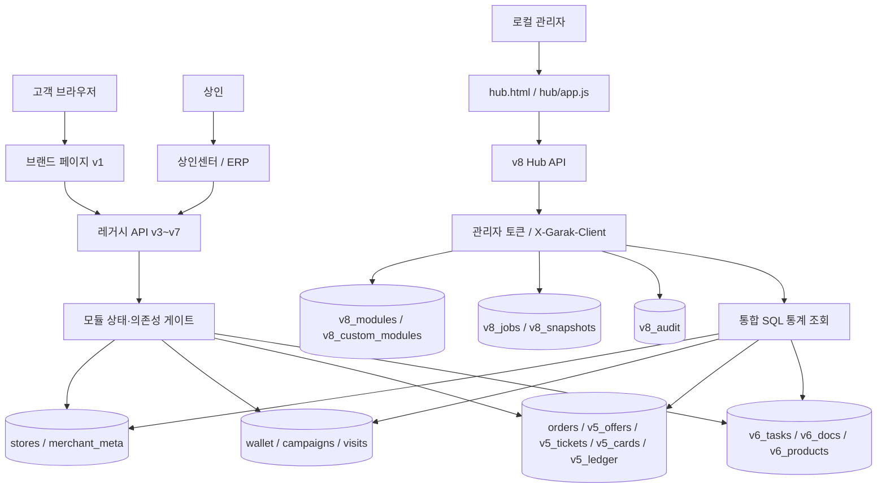

# 가락한상 v2.0 — 모듈 허브 운영 백엔드 설계서

> 발행: 2026-10-29 / 등급: 로컬 기능 베타 / 출시 판단: **NO-GO** (실결제·실발송·실측 위치 미승인)

## 1. 설계 원칙

- 고객용 가락한상 v1과 가락랜드 v3~v7의 기존 API를 **보존**하면서 중앙 관리 기능을 추가한다.
- 업무 영역은 12개 **고정형 모듈**과 추가 가능한 **연결형 모듈**로 구성한다.
- `hub/core.py`는 등록부/설정/작업/통계/감사로그/출시 게이트를 담당하는 **제어계층**이다. 실제 각 기능은 기존 서버 및 서브모듈이 수행한다.
- 기존 코드 및 테스트에서 보장되지 않는 실제 Google 3D 지도, GPS, AR 인식, 결제, PG 정산, SMS·Kakao 발송을 완료라고 주장하지 않는다.
- 단일 서버 내 SQLite로 동작하는 **로컬 베타**이다. 클라우드 운영으로 확장하려면 인증/권한, 스케일링, DB 동시성, 백업·재해복구 및 보안이 추가로 필요하다.

## 2. 아키텍처

### 2.1 소스 위치

| 컴포넌트 | 파일 | 책임 |
|---|---|---|
| 통합 로컬 API | `server.py` | 클라이언트 API, v5/v6/v7/v8 라우팅 및 정적파일 보호 |
| 운영 허브 API | `hub/core.py` | 모듈, 의존성, 통계, 예약 작업, 감사로그, 출시 점검 |
| 운영 허브 UI | `hub.html`, `hub/style.css`, `hub/app.js` | 12개 모듈 카드, 지표, 그래프, 기능·상태 관리 |
| 매장/지도 등록 | `registry_server.py` | 매장 명부, GPS 검증 상태, 관리자 CSV |
| AR·방문·주문 | `server.py` | 가상 탐험/QR/메뉴 및 주문 요청 |
| 공동 특가·상품권 | `market/core.py`, `market/providers.py` | 쿠폰/가상 거래·동의/모의 발송 |
| ERP 운영 | `ops/core.py` | 업무 보드/상품대장/서류/시연 정산 |
| v7 안전 보완 | `bridge_v7.py` | 홍보 링크/준비도 관리 |
| 브랜드 사이트 | `index.html` 외, `brand/` | 가락한상 고객용 사이트 |

## 3. 도메인 모듈 및 의존성

| ID | 모듈 | 선행 모듈 | 주요 기존 서비스 | 관리 범위 |
|---|---|---|---|---|
| `stores` | 매장·상인 마스터 | — | `/api/stores`, `/api/import` | 등록·정정·GPS 검증 |
| `map` | 지도/길찾기 | stores | `map.html`, `market-map.html` | 지도 페이지 및 위치 정보 검수 |
| `ar` | 탐험/QR/스탬프 | stores | `/api/experience`, `/api/checkin`, `/api/recognize` | 방문·인식 시연 |
| `products` | 상품 ERP | stores | `/api/v6/products*` | CSV 품목·가격 검증 |
| `coupons` | 쿠폰·특가 | stores | `/api/coupons/claim`, `/api/v5/*offer*` | 발행·중복·사용 시연 |
| `giftcards` | 연합 시연권 | stores | `/api/v5/*gift*` | 모의 잔액·차감·취소 |
| `orders` | 주문 시연 | stores | `/api/orders` | 메뉴·주문요청 시연 |
| `marketing` | 공동 마케팅 | stores | `/api/v5/consent`, `/api/v5/*broadcast*` | 채널동의·모의 예약 |
| `merchants` | 상인센터 | stores | `/api/merchant/*` 일부 | 상인 프로필·자료 관리 |
| `erp` | 운영·서류 | stores | `/api/v6/task*`, `/api/v6/documents*` | 문서 증빙·업무 카드 |
| `content` | 행사·브랜드 | — | `events.html`, `market-guide.html` | 안내/브랜드 정적 화면 |
| `analytics` | 통계/리포트 | — | `/api/v8/analytics` | 운영 집계, 작업 스냅샷 |

**중지 정책:** 필수 선행 모듈이 사용 중이면 상위(stores)를 중지할 수 없다. 하위 모듈을 먼저 중지해야 한다. 해당 모듈과 매핑된 레거시 API는 HTTP 503을 반환한다. 기존 정적 HTML은 공개 상태로 남고, 연결된 외부 서비스까지 중지되지는 않는다. 모듈 중지는 외부 공급자의 권한 취소와 다르다.

**새 모듈 등록:** `/api/v8/modules/register`는 이미 존재하는 내부 HTML 페이지에 연결할 **운영 카드/메타데이터**를 DB에 등록한다. 보안상 임의 Python 코드, 자동 플러그인 다운로드/실행, 신규 백엔드 생성은 허용하지 않는다. 실제 모듈 개발 후 테스트 및 라우트 매핑 추가가 필요하다.

## 4. SQLite v8 스키마 및 데이터 계보

- `v8_modules(id PK, enabled BOOLEAN, note, updated_at)`: 모듈 상태; 시스템 부팅 시 핵심 12개 등록, 기존 상태는 보존.
- `v8_custom_modules(id PK, name, description, url, created_at)`: 연결형 모듈 정의. URL은 기존 내부 `.html`만 허용.
- `v8_jobs(id PK, kind, module_id, label, due_at, cadence, status, last_result JSON text, run_count, created_at, updated_at)`: 수동 검수 작업. `cadence=once|daily|weekly`.
- `v8_snapshots(id PK, captured_at, payload JSON text)`: 검사 시점 통계 결과를 보존.
- `v8_audit(id PK, action, target, detail JSON text, created_at)`: 모듈 변경·작업 생성/실행/취소 감사로그.

기존 테이블은 **읽기 위주**로 활용한다. `stores`, `v5_offers`, `v5_tickets`, `v5_cards`, `v5_ledger`, `v5_broadcasts`, `v5_outbox`, `v6_tasks`, `v6_docs`, `v6_products`, `wallet`, `visits`, `orders`에서 SQL COUNT 및 날짜별 GROUP BY를 집계한다.

### 4.1 통계 정의 및 주의

| 항목 | 집계 원본 | 해석 |
|---|---|---|
| 등록 점포 | stores count | 전체 등록이며 실제 가락시장 전수 데이터 아님 |
| GPS 검증 점포 | stores.coordinateStatus=verified, 비시연 | 데이터베이스 등록 검증값; 공인 현장 실측 보장 아님 |
| 발행 쿠폰 | v5_tickets + wallet | 두 독립 쿠폰 시스템 **건수 합계**; 유니크 고객 수 아님 |
| 쿠폰 사용률 | v5_tickets.redeemed_at / v5_tickets 수 | v5 시연 쿠폰 기준 |
| 방문 스탬프 | visits | 세션·일 단위 스탬프; 실제 방문자 수 아님 |
| 주문 | orders | 시연 주문 요청 수, 실제 매출이 아님 |
| 상품 | v6_products | ERP 상품대장 등록 수; 실제 온라인 판매 승인과 다름 |
| 상품권 | v5_cards, v5_ledger | 가상 시연권, 법적/금전적 채권 아님 |
| 미리보기 발송 | v5_outbox | 이메일/SMS·Kakao **실제 발송 성공 수가 아님** |

일별 차트는 쿠폰 `created_at`, 방문 `at`, 주문 `created_at`의 ISO 날짜 앞 10자(YYYY-MM-DD) 기준이며 `timezone +09:00`로 저장한 원본의 날짜 부분을 사용한다. 앱 버전별 타임존이 혼재될 경우 운영 이관 단계에서 UTC 통일이 필요하다.

## 5. v8 REST 인터페이스

모든 `/api/v8/*`는 `X-Garak-Admin-Token`을 필요로 한다. 쓰기 작업은 JSON과 `X-Garak-Client: 1` 헤더가 추가로 필요하다.

| Method | Path | 입력 | 출력/처리 |
|---|---|---|---|
| GET | `/api/v8/dashboard` | 없음 | 12+ 모듈, 지표, 14일 추세, 검수·최근 작업 |
| GET | `/api/v8/modules` | 없음 | 전체 등록 모듈 및 상태 |
| GET | `/api/v8/analytics?days=7|14|30|90` | days | 일별 쿠폰·방문·주문, 전체 지표 |
| GET | `/api/v8/jobs` | 없음 | 최대 200건 수동 검수 작업 |
| GET | `/api/v8/audit` | 없음 | 최근 150건 운영 감사로그 |
| GET | `/api/v8/snapshots` | 없음 | 최근 50개 통계 스냅샷 |
| GET | `/api/v8/readiness` | 없음 | 출시 차단 조건 및 충족 여부 |
| POST | `/api/v8/module/config` | `{id,enabled:boolean,note?}` | 의존성 검사 후 상태 변경·감사로그 |
| POST | `/api/v8/modules/register` | `{id,name,description,url}` | 내부 HTML에 연결된 카드 등록, 코드 생성 없음 |
| POST | `/api/v8/jobs/create` | `{kind,moduleId,label,dueAt,cadence}` | `scheduled` 작업 생성 |
| POST | `/api/v8/jobs/run` | `{id}` | 관리자 수동 검수 실행, 결과 저장 |
| POST | `/api/v8/jobs/cancel` | `{id}` | 작업 취소, 감사 기록 |

### 5.1 검수 작업 종류

- `metrics_snapshot`: 그 시점의 통계를 저장한다.
- `coupon_audit`: 동일 세션·행사별 중복 여부를 SQL로 검사한다.
- `readiness_check`: 실제 계약·승인 등 가동 조건의 준비 상태 점검; 실결제 오픈 불가.
- `marketing_preview`: 동의된 채널별 건수만 보고하며 발송은 **0건**.

예약에 따른 크론/데몬 자동 실행은 설계상 구현하지 않는다. 관리자 수동 실행 또는 별도 승인된 작업큐가 필요하다.

## 6. 최소 안전 정책

1. 관리자 토큰은 Windows 실행 콘솔에서 발급한다. 허브 브라우저는 메모리에만 유지하며 localStorage 등에 저장하지 않는다.
2. `X-Garak-Admin-Token`은 비교 타이밍 대응을 위해 HMAC compare_digest로 검증한다. 보안 완성판을 위한 RBAC/세분화 권한은 미구현.
3. 서버는 기본 `127.0.0.1:8769` 바인딩이며 공개 인터넷 배포를 가정하지 않는다.
4. 기존 static guard는 `*.py`, 숨김 파일, sqlite 등 서버 내부 파일에 대한 직접 HTTP 접근을 차단한다.
5. 모듈 추가 URL은 로컬에 존재하는 ASCII 내부 `.html`만 허용하며 임의 HTTP URL/임의 실행 파일 등록을 거절한다.
6. 실결제/선불 상품권 충전/실제 광고 발송은 이 모듈 허브가 켜지게 하지 않는다.
7. 기존 AR의 GPS·사진 비교는 시연/기술적 지원이며 현장 실측과 사기방지 수준을 보장하지 않는다.
8. 백업·복구 점검, 데이터 암호화, 실서버 TLS, 비밀관리, CSRF/리버스프록시/IP 제어, 침투시험, 실사용자 RBAC/2FA, 개인정보 영향 평가가 상용 출시 **필수 과제**다.

## 7. 베타 검증과 인수 조건

- Python 표준 단위·통합·회귀: 97개(기존 v1~v7 + v8 새 테스트) 모두 통과 (검사 로그 첨부).
- v8 서버 통합: 관리자 인증, 타 모듈 의존성, 일별 지표, 동의 집계, 검수 작업, 재실행 방지, 감사로그, HTML 경로 제한.
- 구체적인 교차 흐름: 시연 쿠폰 발급 1건·방문 인증 1건·시연 주문 1건 → v8 대시보드 각각 +1 증감 확인.
- Chromium 1440×900·390×844 오프라인 렌더링+모의 API: 12개 기본 카드, 검색, 토글, 작업 등록/실행, JS 오류 없음, 수평 넘침 없음.
- **미검증:** Google Maps 실제 SDK 키, 실점포 전체 위치, 현장 QR/GPS/AR, 실제 카드 PG·환불·정산, 실문자·카카오·이메일 발송, 웹 로그인/보안 침투, 실운영 클라우드 배포.

## 8. 향후 상용 백엔드 전환 가이드

1. 단일 관리자 토큰 → 서버 세션 + SSO/RBAC(본사운영, 연합회, 상인, 정산, 고객 지원) 및 2FA, 접근 감사.
2. SQLite → Neon/PostgreSQL; Alembic 유사 버전 관리, 민감정보 분리, DB RLS 또는 서비스 계층 권한 검증.
3. 작업 예약 → 승인된 큐/워커(재시도, rate-limit, idempotency, 실패 보관, 예약 변경 취소, 모니터링).
4. 각 외부 시스템(지도, 카카오, 문자, 결제)에 독립된 어댑터와 테스트 모드를 두고 자격증명은 서버 측 Secret Manager에서 관리.
5. 통계 이벤트에는 `source`, `event_id`, `occurred_at`, `shop_id`, `is_demo`, `actor_id`를 표준화하고, PII 최소화와 보존 기간·삭제 요청 처리 적용.
6. 상인 계약·승인된 상품·위치 검증·PG 계약·금융 법률검토·광고 동의 확보 후 단계적 출시에 대한 검토 보고.
7. 테스트: 단위/통합/브라우저 E2E/권한 행렬/부하·동시발행/쿠폰 재사용/공격 시뮬레이션/장부 정합성/백업 복구/현장 GPS 오차 측정.

**최종 판정:** 관리자 허브 및 기존 베타 기능 연동 테스트는 통과. **외부 연동 및 상용 서비스 출시는 NO-GO.**
